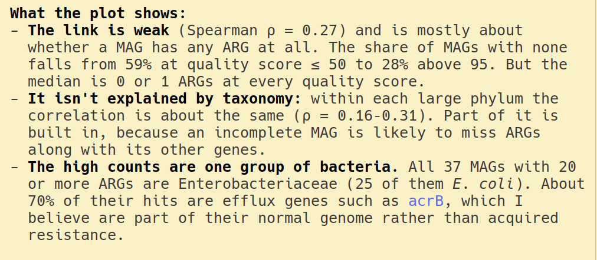

# Prerequisites & learning goals

## Prerequisites

- You have installed `claude`, & can run it on the terminal
- You have a paid account!
- You know how to use basic git
    - `git init`
    - `git add` / `commit`
    - `git diff`
- Ideally, you know Python
- You know the basic concept of conda/pixi

## Workshop mechanics

You should have two post-its: one green and one red. Use them to indicate if you are following along or not.

Sometimes, I will explicitly ask whether you are following along. If you are, put the green post-it up. If not, put the red one up.

If you followed this, put the green post-it up!

## Learning goals

This is an intro to using coding agents. At the end of the session, you should
know

- how to ask `claude` for code
- what `CLAUDE.md` is (including what `/init` does)
- what "context" is and how to work with it


## A note on this field

::: remember
This is a very fast moving field. Best practices are still evolving. The
models/harnesses are constantly changing.
:::


# Accessing LLMs

## Three ways to use an LLM

1. **Chat.** You probably have used this before.
2. **Auto-complete / basic assistant**. You will see this in a modern IDE or
   even Google Docs or Word if you have the right subscription. You type, the
   model suggests completions.
3. **Full agent use.** The agent runs commands and re-evaluates afterwards,
   potentially then running further commands without further requests or
   requests for clarification.


## Best practices from the old typed code world still apply

::: remember
Best practices that applied to human readable code, also apply to AI-generated
code. If anything, agents make them more powerful.
:::

::: handout
Version control, small commits, tests, clear naming, documented decisions,
reproducible environments...
:::


# Case study

## The task

A few tables → visualization in Python with matplotlib and polars. The tables
are in `data/` and the task is to explore them.

You should have received these data files in advance.

::: handout
The data on dogs comes from a real study:

> Cuscó A, Duan Y, Gil F, Chklovski A, Kruthi N, Pan S, Forslund S, Lau S,
> Löber U, Zhao X-M, Coelho LP. *Capturing global pet dog gut microbial
> diversity and hundreds of near-finished bacterial genomes by using long-read
> metagenomics in a Shanghai cohort.* bioRxiv (2025).
> <https://doi.org/10.1101/2025.09.17.676595>
:::

## Step 1: set up basics

```bash
git init
pixi init
git add .
git commit
```

## Introducing pixi

::: aside
Pixi is a declarative package manager

`pixi.toml` + `pixi.lock` completely define the environment. No other state.

This means that if you share with others, they will get the same. With `conda`,
this was very difficult to achieve in a consistent way.
:::

This was good in the typed code era, and even more important in the agent era.

## Step 2: Running claude

```bash
claude
```

```claude
> Hello, claude
> /model
> /usage
```

- `>` … → chat with super-powers (we'll see it in a minute)
- `/` → commands for claude code

## Workshop visual conventions

```bash
ls -l # these are commands you run in the terminal
```

```claude
> This is what you type to claude
```

You can use `CTRL+Z` to suspend a command in the terminal, and `fg` to bring it
back. This works for `claude` as well.

## Step 3: guidelines

Let's set guidelines for claude

- Use pixi, not system tools
- Use matplotlib and polars
- Commit to main
- Document any decisions

## Two ways to do this

1. Write a `CLAUDE.md` file with the guidelines in a text editor
2. Ask claude to write it for you

```claude
> Write a CLAUDE.md file with the following guidelines:
>   - Use pixi, not system tools
>   - Use matplotlib and polars
>   - Commit to main
>   - Document any decisions
```

## Step 4: look at the data

```bash
git add data
git commit -m 'DAT add data from dogs'
```

::: instructor
Inspect the data by _eye_ first.
:::

```claude
> Read the files in data/ 
>
> There is a table & an email from Luis with some incomplete notes
>
> Write a document called data.md with the structure of the data
```

::: handout
I would sometimes type this out, but often it would be based on multi-turn
talking.
:::


## Step 5: basic plots

```claude
> Plot the data. I want to see a stacked bar plot of different qulity categories.
```

First example, a fairly specific request: we specify the type of plot we want.

::: instructor
The typo ("qulity") is deliberate: type it as written. Point out that Claude
does not care: typos and sloppy phrasing in prompts are fine, no need to go
back and fix them.
:::


If Claude does not commit to main, you can ask it to do so:

```claude
> Commit to main
```

## Permission prompts

Claude may ask for permission to run commands. This is a safety feature.

Depending on the permission mode, Claude either asks you or lets an internal
safety classifier decide whether to allow the command.

This has changed fast, and will likely change again. Other harnesses may
handle permissions quite differently.

# Interlude: tokens, context, and what is actually happening

## Building up a picture

Let's start with a simple (in fact, oversimplified) scheme and slowly build up
towards a more accurate picture.

::: handout
Four schemes, each correcting the previous one:

1. You talk directly to the model
2. …with caching
3. …except you talk to a *harness*, which runs tools in a loop
4. …and the model also talks to itself before answering you
:::

## What is a token?

1. word
2. partial word, elements like punctuation

Different systems use different tokenizations too.

For our purposes, if you think that a token is a word/punctuation, you're
probably in the right ballpark.

## Scheme 1: talking directly to the model

You type

"Good morning, claude!"

↓

[`Good` `morn` `ing` `,` `claude` `!`]{.tokens} → 6 tokens

⟿ *Magic* ⟿

→ [`Good` … `, Luis!`]{.tokens} ⟵ 6 tokens

## Scheme 1, second turn

"How are you today?"

↓

tokens **+ context!**

::: remember
The model has no memory between calls. The *entire* conversation is re-sent
every single turn.
:::

## Pricing

Two pricing schemes:

1. Per token (typically, different for input vs output)
2. Subscription with usage limits

Current API prices: <https://claude.com/pricing#api>

::: instructor
Open the pricing page live rather than quoting numbers: prices change, and the
page shows input, output and cache-read prices side by side, which sets up
Scheme 2 (caching).
:::

::: remember
Either way, using fewer tokens is better. If paying per-token, it's a direct
linear relationship; if on a subscription, you want to avoid usage limits.
:::

## Scheme 2: caching

Providers cache the state, so if you reply fast, you don't pay full price for
the previous bits of conversation.

{width=80%}

::: handout
Because every turn re-sends the whole conversation, the total sent grows with
the *square* of the number of turns. With caching, the part the provider has
already seen is billed at a fraction of the normal price (about 10% for a cache
read at Anthropic), which flattens the curve but does not make it go away. The
cache expires after a few minutes of inactivity, after which the next turn pays
full price again.
:::

## Scheme 3: there is a harness

::: remember
You are **not** talking to the model.\
You are talking to a **harness**.
:::

This is true even on the web, but the code harness does a lot more:

1. Reads files (`CLAUDE.md`)
2. Executes commands

## Scheme 3: what actually gets sent

```{.dot width=100%}
digraph sent {
  rankdir=LR; bgcolor=transparent; nodesep=0.3; ranksep=0.45;
  node [fontname="DejaVu Sans", fontsize=16, shape=box, style="rounded,filled",
        fillcolor=white, color="#37474f", fontcolor="#263238", penwidth=1.5, margin="0.18,0.1"];
  edge [fontname="DejaVu Sans", fontsize=13, color="#37474f", fontcolor="#37474f", penwidth=1.5, arrowsize=0.8];

  you     [label="you type\n“Look at the files in data/”\n≈ 8 tokens", style="", shape=plain];
  harness [label="harness", fillcolor="#37474f", fontcolor=white];
  request [shape=plain, style="", label=<
    <table border="1" color="#37474f" cellborder="0" cellspacing="0" cellpadding="7">
      <tr><td align="left"><b>what is sent to the model</b><br align="left"/><font point-size="13">thousands of tokens</font><br align="left"/></td></tr>
      <tr><td align="left" bgcolor="#eceff1">system prompt</td></tr>
      <tr><td align="left" bgcolor="#eceff1">tool definitions</td></tr>
      <tr><td align="left" bgcolor="#eceff1">CLAUDE.md</td></tr>
      <tr><td align="left" bgcolor="#eceff1">memories</td></tr>
      <tr><td align="left" bgcolor="#eceff1">conversation so far</td></tr>
      <tr><td align="left" bgcolor="#f6d9cd"><i>“Look at the files in data/”</i>  <font point-size="13">← your 8</font></td></tr>
    </table>>];
  model   [label="model", fillcolor="#d97757", fontcolor=white, color="#d97757"];
  call    [label="tool call:\nrun ls", fontname="DejaVu Sans Mono"];

  you -> harness -> request -> model -> call;
}
```

::: handout
Your 8 typed tokens have become a much larger request containing `CLAUDE.md`,
any stored memories, the conversation so far, and the tool definitions. Then the
`ls` output is appended and the whole thing is sent *again*.
:::

## Scheme 3b: the loop

Scheme 3 showed one command. The important part is that it does not stop at one:

```{.dot width=75%}
digraph loop {
  rankdir=LR; bgcolor=transparent; nodesep=0.7; ranksep=0.7;
  node [fontname="DejaVu Sans", fontsize=16, shape=box, style="rounded,filled",
        fillcolor=white, color="#37474f", fontcolor="#263238", penwidth=1.5, margin="0.18,0.1"];
  edge [fontname="DejaVu Sans", fontsize=13, color="#37474f", fontcolor="#37474f", penwidth=1.5, arrowsize=0.8];

  you     [label="you type", shape=plain, style=""];
  context [label="context\n(everything so far)"];
  model   [label="model", fillcolor="#d97757", fontcolor=white, color="#d97757"];
  harness [label="harness\nruns the tool", fillcolor="#37474f", fontcolor=white];
  done    [label="text for you", shape=plain, style=""];

  you -> context;
  context -> model [label="sent"];
  model -> harness [xlabel="tool call  "];
  harness -> context [label="output\nappended"];
  model -> done [label="decides\nit is done", style=dashed];
  {rank=same; model; harness}
}
```

Each time round: the model emits a tool call, the harness runs it, **the output
is appended to the context**, and the model can decide what to do next until it
eventually decides to output text for you.

## Scheme 4: models talk to themselves

Reasoning traces

The model will output tokens that it then uses to output more tokens before
finally deciding to output user-visible tokens.

## Bottom line

::: remember
- the token count is not what you see on screen
- every message includes all previous messages
- you type a tiny fraction of the tokens
- caching changes things
:::

## Limiting context size

Two reasons:

::: remember
1. because you pay for it (money, or rate limits)
2. **because models do worse as context grows**
:::

## Tools: `/clear` and `/compact`

```claude
> /clear
> /compact
```

::: remember
- `/clear`: wipe the conversation. Equivalent to exiting and starting a new
  session.
- `/compact`: summarise the conversation and continue from the summary.
:::

## Before you `/clear`

::: remember
Get the durable part out of the conversation and into something permanent:

- Saving to `CLAUDE.md` (conventions, decisions, how to run things)
- Saving to other files (`data.md`, notes, docstrings, etc.)
- Committing to git
:::

## Aside: subagents

::: aside
We have left out subagents and other advanced features, which further complicate
the picture.
:::

::: reference
Subagents, hooks, MCP servers, output styles and custom slash commands are all
worth reading about once the basics are comfortable. We will not cover them.
:::

# Back to the case study

## Step 6: exploration {.shrink}

Some potential prompts

```claude
> Plot the distribution of quality categories by taxonomy.
```

```claude
> Do it for family and genus as well.
```

```claude
> Plot the quality score (completeness - 5 * contamination) against genome size.
```

```claude
> Download `https://zenodo.org/records/16356977/files/SHD1_ARGs_MAGs.csv.gz?download=1` and match it against the MAGs. Plot the number of ARGs vs. the quality score.
```

## Claude commentary



This will likely be different for you (the results are not deterministic).

## Follow-up questions

You can ask follow up questions, for example

```claude
> why does it matter that it is part of their normal genomes and not acquired resistance?
```

Again, the answer will likely be different for you, but for me the answers were
quite good!

## Creating a CLAUDE.md file from the project

We created a `CLAUDE.md` file with the guidelines, but we can also ask claude to create
one for us based on the project so far. This is useful if you have a
pre-existing project and want to start using claude.

```claude
> /init
```

## Wrap-up

You should now know

- how to ask `claude` for code
- what `CLAUDE.md` is (including what `/init` does)
- what "context" is and how to work with it

## Discussion. Q&A

Questions?
