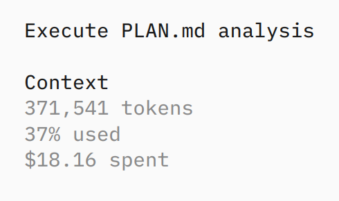

::: handout
Feedback, corrections and questions are very welcome. The best ways to reach
me are to open an issue at <https://github.com/luispedro/vibe-workshops/issues>
or to email me at <luis@luispedro.org>.
:::

# Prerequisites & learning goals

## Prerequisites

- You did Workshop 1 (or are comfortable with everything in it)
- `claude` installed and working, paid account
- Basic git, basic Python, conda/pixi

## Learning goals

- Understand how we can use `claude` for longer-term projects
- Expand your understanding of what is possible with `claude`


::: aside
This session does not present _best practices_! These are still being discovered (and even changing with model/harness updates).
:::

::: handout
I think that the most important thing is to understand what is possible, and
then to try to have these abilities in your toolbox and _top of mind_ when you
are doing your work.

This session presents a _working_ approach and shows a few examples from my own
work that have worked _for me_. I am very happy to learn about other
approaches and to discuss them.

I think it is through the sharing of different approaches and experiences that
we will eventually converge on best practices.

:::

## The missing middle

There is a gap between the single-shot prompts of Workshop 1 and the
longer-term projects we will discuss here.

- _Skills_: a fancy way to organise & share markdown files
- _Parallel worktrees_: multiple agents working at the same time
- _Subagents_: agents that can call other agents

I do not think these are as important as they seemed back in the early days of
the field (2025).

::: handout
::: reference
**Skills.** A skill is a folder holding a `SKILL.md`. The file opens with a
short `description`, followed by instructions, and the folder can also hold
reference files and scripts. Until a task matches the description, Claude
sees only the description, so an unused skill costs almost no context. Put
skills in `~/.claude/skills/<name>/` to use them in all your projects, or in
`.claude/skills/<name>/` to commit them with one project. You can also run a
skill yourself by typing `/<name>`.

- *How to write one:* the
  [Claude Code skills docs](https://code.claude.com/docs/en/skills) and
  Anthropic's
  [authoring best practices](https://platform.claude.com/docs/en/agents-and-tools/agent-skills/best-practices).
- *Why they exist:* Anthropic's
  [engineering post](https://www.anthropic.com/engineering/equipping-agents-for-the-real-world-with-agent-skills),
  and Simon Willison's
  [*Claude Skills are awesome, maybe a bigger deal than MCP*](https://simonwillison.net/2025/Oct/16/claude-skills/).
- *Not just Claude:* the format is an open standard,
  [agentskills.io](https://agentskills.io), and
  [Codex reads skills too](https://developers.openai.com/codex/skills).
- *Examples:* [anthropics/skills](https://github.com/anthropics/skills); for
  science,
  [K-Dense-AI/claude-scientific-skills](https://github.com/K-Dense-AI/claude-scientific-skills)
  and Anthropic's
  [Claude for Life Sciences](https://www.anthropic.com/news/claude-for-life-sciences).
- *Sharing a set of skills:*
  [plugins](https://code.claude.com/docs/en/plugins) and
  [plugin marketplaces](https://code.claude.com/docs/en/plugin-marketplaces).

**Ship a skill with your tool.** If you maintain a tool, a skill in its
repository teaches agents how to use it. My skills for
[Jug](https://github.com/luispedro/jug/tree/main/jug/skills/jug),
[NGLess](https://github.com/ngless-toolkit/ngless/tree/main/skills) and
[SemiBin](https://github.com/BigDataBiology/SemiBin/tree/main/SemiBin/skills/semibin)
are examples.
:::
:::

## Structure of the session

1. Using `claude` for longer-term projects in bioinformatics: more than a single-shot prompt
2. Using `claude` for computational biology: from a vague question to a complete analysis

Both of these are presented as case studies with an exercise in part 1.

Unlike for the first workshop, we will not be running these live due to time constraints.

::: instructor
Mention that _bioinformatics_ is about building tools and _computational biology_ is about answering questions with data. The former is more structured, the latter is more open-ended.
:::

# Using `claude` for longer-term projects

1. Create a `GOALS.md` file.
2. Ask `claude` to write a plan for the project and save it to `PLAN.md`.
3. Repeatedly ask `claude` to continue working on the plan until it is complete.

It's Markdown all the way down.

## Create a GOALS.md

`GOALS.md` is a spec for the project:

- goals and non-goals
- technological choices (_e.g._, Python 3.15, using pixi for environment management)

You can write it by hand, or build it up over a conversation with `claude`:

```
Goals:

- Take a directory of FASTQ files and produce an HTML report with read counts,
  length distributions and quality scores per sample

Non-goals:

- It does not need to run on platforms other than Linux

Technologies:

- Python & pixi
- Use latest versions of libraries, unless there is a good reason not to
- ...
```

## Create a PLAN.md

```claude
See GOALS.md. Review the goals and write a plan for the project, then save it to 'PLAN.md'. The plan should include milestones and deliverables, and should be structured in a way that allows for iterative development and verification of correctness.
```

::: handout
If you look at the history of some of the projects I show next, you can see
that the separation between `GOALS.md` and `PLAN.md` was not always kept. This
is not strictly necessary, but I do like to separate the more human-focused
`GOALS.md` from the more machine-focused `PLAN.md`.
:::

## Example PLAN.md: NGLess, Haskell → Rust

[The plan: `rust-migration.md`](https://github.com/ngless-toolkit/ngless/blob/e5393c800cc342e1cbf67ae280bc80e8bcf182aa/rust-migration.md)

- 168 lines, 10 milestones
- Old: ~13.7k lines of Haskell (+ C/C++ FFI)
- Each milestone *gated* by the existing 112 functional tests
- Plan's own estimate: **6–12 months**
- Actual: Haskell removed after **9 days** (104 commits); v1.6.0 six weeks later
- New: ~25k lines of Rust, 300 unit tests

::: handout
[NGLess](https://github.com/ngless-toolkit/ngless) is a domain-specific
language for NGS (metagenomics) processing, written in Haskell since 2012. The
rewrite started on 22 June 2026 with a single commit containing the plan
(`rust-migration.md`; the file name does not matter) and a scaffold that did
nothing but print `--version`. The link above is to the plan as it was first
committed.

The plan recorded *why* (build and maintenance pain, not performance), the
scope decision (only scripts declaring `ngless "1.5"` or newer would be
supported), what was cheap to port and what was genuinely hard (streaming,
feature counting), and a crate for every Haskell library. Most importantly, it
made the existing functional test suite (112 scripts with expected outputs,
driven by `run-tests.sh`) the definition of done: the first milestone was
making the test runner accept any binary, before writing any interpreter
code.

- 22 June: plan + scaffold (milestone 1)
- 1 July: Haskell implementation deleted; v1.6.0-beta1 released (104 commits)
- 4 August: v1.6.0 released (162 commits since the start)

The plan's estimate for this was "6–12 months of focused work for a small
team". Today, `rust-migration.md` is 14 lines: it turned from a plan into a
list of the remaining known gaps.
:::

::: instructor
Click through to the plan and scroll it live: the milestones list, with a
"Gate:" on each, is the part to show.

The key point is the test oracle, not the speed. The agent could move fast
because "done" was mechanically checkable: same outputs as the Haskell binary
on the existing suite. Without that, 9 days of commits would have been 9 days
of unverified code. Ask the room: what is the equivalent of `tests/` for your
analysis?
:::

::: handout
**Another example: luish.** [luish](https://github.com/luispedro/luish) is a
POSIX shell written from scratch in Rust. There was no old code to port, so the
plan
([`PLAN.md`](https://github.com/luispedro/luish/blob/bdb9f18b5152b7db354e280b4339342d475a926d/PLAN.md),
700 lines, written on 26 September 2026) had to supply what the NGLess test
suite supplied:

- goals: POSIX conformance; as fast as `dash`; plugins in Python, at no cost
  unless loaded; arguments, variables and filenames as arbitrary bytes;
- *non-goals*: no bash arrays, no `[[ ]]`, no Windows, at least initially;
- a table of key design decisions with their rationale (raw
  `fork()`/`execve()` because subshells need a fork without an exec;
  `Vec<u8>` throughout because POSIX data is bytes);
- a repository layout;
- a reference implementation to settle ambiguities: "when the spec is
  ambiguous, match `dash`".

The core (parser, expansion, executor, built-ins) was committed on the same day
as the plan, and v0.1.0 was tagged the next day; v0.7.1 came three weeks
later. Three weeks in, the Oils shell spec tests were added as an external
check. After one month: 349 commits and ~53k lines of Rust, and luish has
replaced zsh as my default shell.

As the project matured, the plan shrank (700 → 228 lines) and the goals moved
to a separate, human-written `GOALS.md`. Some of the original non-goals (arrays,
`[[ ]]`) are now features: the plan is a starting point, not a contract.
:::

::: instructor
Common thread across both: the plan defines how "done" is checked (the
existing test suite for NGLess; POSIX, with `dash` as the reference
implementation, and later the Oils spec tests for luish). That is the part to
emphasize for science: the analysis equivalent is a sanity check, a known
result to reproduce, or a stopping point where you look at the data yourself.
:::

## Bioinformatics tools ported to Rust

::: reference
- [rewrites.bio](https://rewrites.bio): principles for AI-assisted rewrites —
  credit the authors, match outputs exactly, disclose how it was done
- [RustQC](https://seqera.io/blog/rustqc/): 15 RNA-seq QC tools in one, >60×
  faster
- [Henriksson lab](https://www.henlab.org/files/2026_rust_translation_preprint.pdf):
  ~20 tools (BWA-MEM2, minimap2, DIAMOND, HMMER, Kraken2, Prokka, htslib, …)
- fgumi, fastVEP, RastQC, sshash-rs, rust-fastqtl, dada2-rs, …
:::

::: handout
All of these are from 2026, and almost all describe themselves as experimental.
Speed and correctness claims are the authors' own.

| Rust port | Original (language) | Notes |
| --------- | ------------------- | ----- |
| [RustQC](https://github.com/seqeralabs/RustQC) | dupRadar (R), featureCounts (C), 8 RSeQC modules (Python), preseq, `samtools` stats, Qualimap RNA-Seq | Seqera, with Claude Code. featureCounts counts byte-identical; MultiQC reads the outputs unchanged. Weeks of validation |
| [fgumi](https://github.com/fulcrumgenomics/fgumi) | part of fgbio (Scala) | Fulcrum Genomics |
| [fastVEP](https://github.com/Huang-lab/fastVEP) | VEP (Perl), Nirvana (C#) | Huang lab, with a bioRxiv preprint |
| [RastQC](https://github.com/Huang-lab/RastQC) | FastQC (Java) | Huang lab; drop-in replacement |
| [sshash-rs](https://github.com/COMBINE-lab/sshash-rs) | sshash (C++) | COMBINE-lab |
| [rust-fastqtl](https://github.com/huangnengCSU/rust-fastqtl) | fastqtl (C++, unmaintained) | |
| [dada2-rs](https://github.com/HPCBio/dada2-rs) | DADA2 (R/C++) | HPCBio; AI-assisted commits labelled; follows rewrites.bio |
| [henriksson-lab](https://github.com/orgs/henriksson-lab/repositories) | BWA-MEM2, minimap2, STAR, DIAMOND, MUSCLE, HMMER, Kraken2, Prodigal, Prokka, SKESA, FastQC, AMRFinderPlus, htslib, Bio-Formats, … | Claude Code and Codex, 11 weeks. Naive prompts lost most features; one function at a time, checked by static analysis, worked. BLAST failed twice |

[rewrites.bio](https://rewrites.bio) is Seqera's set of principles that grew out
of RustQC. [Heng Li's "The AI rewrite
dilemma"](https://lh3.github.io/2026/04/17/the-ai-rewrite-dilemma) is the view
from a maintainer whose tools get rewritten: in favour on technical grounds, but
"empathy matters more than technical benefit or legal correctness".
:::

::: instructor
Do not present the list; point at it and move on (under a minute). The one
thing to say: every port that worked had an oracle, the original tool's
outputs. RustQC matches featureCounts byte for byte; Henriksson found that
"translate this" without checks gave code missing most features.
:::

## Use a `working-memory.md` file


```claude
See 'working-memory.md' for context. Continue working until you have made a self contained change and then commit. Update 'working-memory.md' so that a new session will be able to pick up where you left off. Print a summary of the status for the user.
```

Let it run, use `/clear` to clear the context, and repeat until you are finished.

::: handout
The name `working-memory.md` is my own convention; nothing in Claude Code
treats it specially. The pattern is widely used, though: keep the state of a
long task in a file, start each session with a fresh context that reads it,
and update it before stopping. Some other versions of it:

- Anthropic's [harness for long-running
  agents](https://www.anthropic.com/engineering/effective-harnesses-for-long-running-agents)
  uses `claude-progress.txt`, a feature list and the git log, read at the
  start of every session.
- Anthropic's [context engineering
  guide](https://www.anthropic.com/engineering/effective-context-engineering-for-ai-agents)
  calls it *structured note-taking* (e.g., a `NOTES.md` outside the context).
- Cline's [Memory Bank](https://docs.cline.bot/prompting/cline-memory-bank) is
  a `memory-bank/` folder, with `activeContext.md` and `progress.md` for the
  current state.
- [Manus](https://manus.im/blog/Context-Engineering-for-AI-Agents-Lessons-from-Building-Manus)
  keeps a `todo.md` that the agent rewrites as it goes.
- Geoffrey Huntley's [Ralph loop](https://ghuntley.com/ralph/) runs the agent
  in a shell loop, each time with a fresh context and a plan file on disk.
:::

## Keep `working-memory.md` out of git

This is a matter of personal preference, but I keep `working-memory.md` out of git because it is scratch state for the agent, not part of the project history.

```bash
echo 'working-memory.md' >> .git/info/exclude
```

## Clean up the working memory

Every so often, you can ask `claude` to clean up the `working-memory.md` file.

```claude
Please clean up the 'working-memory.md' file to remove any information that is no longer relevant to the current state of the project. Make sure it only contains context that will help a new session pick up where we left off.
```

## What are good projects for this approach?

The best is a _clear, automatable (verifiable) definition of correctness_

Migrations are a perfect example: the old code is assumed to be correct and the new code is verified against it.

## Making your domains (more) verifiable

1. **Mathematical proof**: rarely achievable for bioinformatics
2. **Exact check**: checking the answer is easy and fast
3. **Known reference**: compare against a trusted output
4. **Invariants**: check properties of the output, not the output itself
5. **Plausibility**: what you expect to see, but no ground truth
6. **Diff and judge**: compare to the last version; a human decides
7. **Judgement only**: a human (or another model) needs to evaluate it

::: remember
Think about how to move your problem as high as possible!
:::

::: handout
Real projects may hit several of these:

1. **Mathematical proof.** Perhaps relevant for a new algorithm, where we can
   prove that the implementation is correct. Otherwise, rarely achievable for
   bioinformatics.
2. **Exact check.** Sorting: the output is in order and has exactly the same
   records as the input; together, these two checks _are_ the definition of
   sorting. Gene calls: extract each predicted ORF from the genome, translate
   it, and compare it with the reported protein (this catches off-by-one and
   strand errors).
3. **Known reference.** A strong version is where you can have an _oracle_ that
   can apply to any input. For example, ports, where the original tool is the
   oracle (NGLess Haskell → Rust; RustQC vs featureCounts). Perhaps you can
   have a slower version as a reference (e.g., BLAST vs. DIAMOND, which agree only within a tolerance, as DIAMOND
   trades some sensitivity for speed). As a weaker
   version, you can have some known input/output pairs (e.g., simulated data)
   and check those, or check the classification of reference genomes whose
   taxonomy you already know.
4. **Invariants.** Reads are conserved: input = kept + filtered, mapped +
   unmapped = total. Relative abundances sum to 1, counts are never negative,
   every sample in the metadata is in the table. Each contig is in at most one
   bin. Predicted genes have a length divisible by 3, a start codon, and no
   internal stops. Reverse complement applied twice is the identity. Parse →
   write → parse round trips: your tool writes a file that can be read back in
   and gives the same data structure (this misses bugs shared by the reader and
   the writer). Passing these does not make a result right, but failing any of them makes it wrong.
5. **Plausibility.** Gut profiles where the expected phyla dominate, and dog
   guts look like dog guts. Technical replicates sit closer together than
   biological replicates in a PCoA. Antibiotic exposure lowers alpha diversity.
6. **Diff and judge.** When code changes, does the output change?
7. **Judgement only.** The output is what it is and you have to decide if it
   makes sense.

Climbing a rung: simulate a community and binning moves from 5 to 3; write
"technical replicates are closer than biological ones" as a test and it moves
from 5 to 4; save today's outputs on ten samples and you have a 6 where you had
nothing.
:::

::: instructor
About two minutes. Point out that migrations are rung 3, which is why they work
so well. The line to land is the box: you can climb. Then ask the room which
rung the tool they are about to plan sits on, and have them keep that question
in mind during the exercise. Rung 7 is a pointer to the ECE case study, where
the critique comes from a second model.
:::

## Hands-on: goals for a tool

Pick a tool you would find useful, write its `GOALS.md`, and iterate on it
with `claude`. If you have time, have `claude` generate a `PLAN.md` from it.
No implementation today.

```bash
mkdir goals-exercise
cd goals-exercise
claude
```

```claude
I would like to write a tool that ... Help me write the goals, non-goals and technological choices for it, then save them to 'GOALS.md'. Do not write a plan or start implementing it.
```

::: remember
You can specify as much or as little detail as you want.
:::

## Hands-on: iterate, then plan

Iterate on `GOALS.md`: ask `claude` what is missing or ambiguous, and edit it
yourself too.

If you have time, generate the plan:

```claude
See GOALS.md. Review the goals and write a plan for the project, then save it to 'PLAN.md'. Do not start implementing it.
```

::: handout
Besides the goals, non-goals and technological choices from "Create a
GOALS.md", ask yourself:

- What goes in and what comes out (file formats, a figure, a report)?
- For a visualisation, tests can check the numbers but not the picture. Have
  the tool write out the table behind each figure, and make "look at the plot"
  an explicit step.
:::

## Some ideas, or bring your own

| Idea                                | Outputs             |
| ----------------------------------- | ------------------- |
| Quality report for metagenomic bins | Navigable webpage   |
| Coverage and GC skew per contig     | Stats/plots         |
| Resistance genes across samples     | Stats/plots/webpage |

A tool from your own work is better than any of these!

::: remember
How verifiable can you make it?
:::

**~15 minutes:** 5 for a first `GOALS.md`, 5–10 to iterate on it (with
`claude` and by hand), then `PLAN.md` if you have time. Then we discuss.

::: instructor
About 20–25 minutes in total: ~15 minutes of work, following the timings on
the slide, then 5–10 minutes of discussion. In the discussion, look at two or
three `GOALS.md` files from the room (and a `PLAN.md`, if anyone got that far).

This is a thought exercise: there is no data, and nobody should be running
anything.

People who are stuck choosing: tell them to take the first idea. People
outside microbiome: their own work is better than any of these.
:::

::: handout
**A reflection:** I used to argue that one should separate scientific code into
code that is part of a single paper, which I called _Extended Methods_, and
code that is meant to be used by others as a _tool_. I even wrote a
perspective paper about it ([Coelho, _PLOS Comput Biol_
2024](https://journals.plos.org/ploscompbiol/article?id=10.1371/journal.pcbi.1011920)).

In particular, I argued that elevating code from Extended Methods to a tool
takes a lot of effort (roughly 5–10×), and so it is not always worth doing.
I also argued that maintenance is a large cost that one should consider before
deciding to make a piece of code into a tool.

With agents, though, the cost of going from Extended Methods to a tool is much
lower, and it may make sense to use the full infrastructure of a tool (_e.g._,
full test coverage, CI) even for code that is only used in a single paper.
Maintenance is still a cost, but it is much lower than before. For example, a
failure after an update of a dependency can generally be fixed with a single
prompt to the agent.
:::

## Similar structure for reviewing projects

```claude
Please review this project, focusing on the code and write a list of all the issues to a file called 'review.md'. Be exhaustive and include any potential improvements, bugs, or areas that need clarification. Make sure to provide clear explanations for each issue you identify.
```

or

```claude
Please review this project, focusing on the documentation and text and write a list of all the issues to a file called 'review-docs.md'. Be exhaustive and include any potential improvements, bugs, or areas that need clarification. Make sure to provide clear explanations for each issue you identify.
```

```bash
echo 'review.md' >> .git/info/exclude
echo 'review-docs.md' >> .git/info/exclude
```

## Fix issues from the review

```claude
See 'review.md' for context. When fixing issues, completely remove them from 'review.md' (do not just mark them as fixed). Fix #8
```

Obviously, you can review the issues first or add more information:

```claude
See 'review-docs.md' for context. When fixing issues, completely remove them from 'review.md' (do not just mark them as fixed). Fix #9 by changing the code to match what the documentation promised.
```

NB: The numbers `#8` and `#9` refer to the issue numbers in the review files and will be different for each project.

:::instructor
Make a note that claude will often categorize issues into groups, so there may be numbers and letters or hierarchical numbering. The important thing is that the user can find the issue in the review file and remove it when fixed.
:::

# Using `claude` for computational biology

This is the harder setting! Give `claude` a dataset and a question, and let it explore the data.

It will operationalize your question into a set of analyses and run them.

::: remember
The reason why this is harder is that it is less clear what _correct_ means.
:::


## The data

We will work with the same dog gut microbiome dataset as in Workshop 1, but now we will focus on extra-chromosomal elements (ECEs).

We extracted the ECEs from the assemblies and want to know how they replicate.

## The question

[`analysis.md`](https://github.com/luispedro/dogs-ece-replication/blob/beb043d01737a1d455a69a5dc931259cb6d5eeaa/analysis.md):

```text
# ECE replication

## Data

Data is available at https://zenodo.org/records/16356977. In
particular, I want to analyse the extra-chromosomal elements (ECEs).

## Question

How do the ECEs replicate? Is it different between the different
types of ECEs? Are there patterns in the replication mechanisms that
can be identified?

## Technology

- Use pixi to install the necessary packages in a reproducible way
  (do not rely on the system python).
- Use jug + python + matplotlib to coordinate the analysis and
  generate plots.
```

::: instructor
Note that the phrasing is still short and vague.
:::

## Asking `claude` to plan the analysis

```claude
See the desired analysis in 'analysis.md'. Please sketch out how to operationalise it
```

::: handout
Between these two prompts there is usually some back and forth: read the
sketch, correct what is wrong, and ask again.
:::

```claude
Save this plan to a file called 'PLAN.md'.
```

## What did `claude` come up with?

[`PLAN.md`](https://github.com/luispedro/dogs-ece-replication/blob/beb043d01737a1d455a69a5dc931259cb6d5eeaa/PLAN.md)

Here is where you can iterate with `claude` or other models to refine the plan.

## Running it

```claude
Execute the analysis in PLAN.md
```

Let it run.

::: remember
Every time you run this, you will get a different result.

Not even just a different result, but potentially a completely different analysis!
:::

## It takes a few hours

This ran for a bit over 2 hours on my laptop, independently without further
human intervention.


{width=40%}

Full outputs: [dogs-ece-replication](https://github.com/luispedro/dogs-ece-replication),
starting with [`REPORT.md`](https://github.com/luispedro/dogs-ece-replication/blob/beb043d01737a1d455a69a5dc931259cb6d5eeaa/REPORT.md)

::: handout
I ran this with _Claude Opus 5.5_ from within `opencode`, which shows the token usage, but it should otherwise be equivalent to using the `claude` command line tool.
:::

::: handout
From my point-of-view, this was a single-shot prompt, but from its
point-of-view, it was iterative:

By monitoring the process, it was clear that it ran analyses, then re-assessed
the process, changed the code, and re-ran the analyses.
:::

## We can ask for critique

I actually asked _Luna_ (the OpenAI model) to critique the analysis:

```{.no-cue}
Criticize the analysis that Claude performed in this project.
```

(Anecdotally, the models enjoy critiquing each other.) The critique:
[`luna-review.md`](https://github.com/luispedro/dogs-ece-replication/blob/beb043d01737a1d455a69a5dc931259cb6d5eeaa/luna-review.md)

# Wrap-up

- You can use `claude` for longer-term projects, both in bioinformatics and computational biology
- You can use `claude` to review projects and fix issues
- Separate `GOALS.md`/`PLAN.md`/`review.md` from execution
- Use a `working-memory.md` file to keep track of the state of the project and the context small

::: remember
These are all evolving practices
:::

## Good agent problems

One or both of:

1. A clear, automatable definition of correctness (high on the ladder)
2. A lot of boilerplate code

**Examples:**

- Ports to a new language or framework; dependency upgrades
- Making a tool faster or more memory-efficient
- Adding tests to untested code
- Packaging a script as a tool
- Making a companion website for a paper

::: handout
Where each example sits, and a few more. The rung in brackets refers to the
ladder in "Making your domains (more) verifiable".

Clear correctness, because an oracle or a test exists:

- **Upgrading dependencies or APIs** (Python 2 → 3, pandas 1 → 2, Snakemake
  7 → 8, Nextflow DSL1 → DSL2) is a migration in all but name: the outputs
  before the upgrade are the oracle [3].
- **Making a tool faster** also has the old version as its oracle [3], and the
  benchmark tells you whether you are done.
- **Turning a pile of shell scripts into a Snakemake or Nextflow pipeline**:
  the outputs should be identical to those of the scripts [3].
- **Adding tests to untested code**: freeze today's outputs on a few inputs as
  golden files, then refactor against them. This turns a 7 into a 6.
- **Turning bug reports into failing tests**, then fixing them: "the test now
  passes" is a very clear definition of done [2].
- **Parsers and format converters** (GFF ↔ GTF, vendor formats) get a
  round-trip invariant for free [4].
- **Reproducing a paper's figures from its released data**: the published
  figure is the reference [3, or 5 if only roughly].

Mostly boilerplate:

- **Packaging a script as a tool**: a command-line interface,
  `pyproject.toml`, a bioconda recipe, CI, a container image. This is the
  _Extended Methods_ → tool step, made cheap.
- **Documentation with runnable examples**: tutorials or doctests that CI
  executes, so the documentation is itself checked.
- **Harmonising metadata across studies** into one schema: tedious, and
  validating against the schema is the check.
- **Benchmark harnesses**: run several tools on simulated data and collect the
  results into one table.
- **A companion website for a paper**: little to verify beyond looking at it,
  but it is cheap to be wrong and easy to redo.
:::

## Discussion. Q&A

Questions?

::: remember
The handouts have more than the slides: notes, asides and references for
later. Read them at <https://luispedro.github.io/vibe-workshops/>
:::
