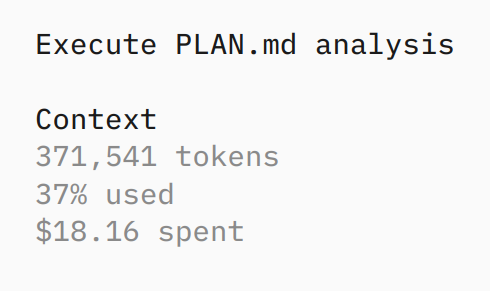

# Prerequisites & learning goals

## Prerequisites

- You did Workshop 1 (or are comfortable with everything in it)
- `claude` installed and working, paid account
- Basic git, basic Python, conda/pixi

## Learning goals

- Understand how we can use `claude` for longer-term projects
- Expand your understanding of what is possible with `claude`


::: aside
This session does not present _best practices_! These are still being discovered (and even changing with model/harness updates).
:::

::: handout
This session presents a _working_ approach and shows a few examples from my own work. I am very happy to learn about other approaches!
:::

## Structure of the session

1. Using `claude` for longer-term projects in bioinformatics: more than a single-shot prompt
2. Using `claude` for computational biology: from a vague question to a complete analysis

Both of these are presented as case studies with an exercise in part 1.

Unlike for the first workshop, we will not be running these live due to time constraints.

::: instructor
Mention that _bioinformatics_ is about building tools and _computational biology_ is about answering questions with data. The former is more structured, the latter is more open-ended.
:::

# Using `claude` for longer-term projects

1. Create a `PLAN.md` file.
2. Repeatedly ask `claude` to continue working on the plan until it is complete.

It's Markdown all the way down.

## Create a PLAN.md


```claude
I would like to do ...
```

This can be built up over a conversation, but you want to design a spec for the project:

- goals and non-goals
- technological choices (_e.g._., Python 3.15, using pixi for environment management)
- important steps, milestones, and deliverables (`claude` will often provide these)

## Example PLAN.md: NGLess, Haskell → Rust

[The plan: `rust-migration.md`](https://github.com/ngless-toolkit/ngless/blob/e5393c800cc342e1cbf67ae280bc80e8bcf182aa/rust-migration.md)

- 168 lines, 10 milestones
- Old: ~13.7k lines of Haskell (+ C/C++ FFI)
- Each milestone *gated* by the existing 112 functional tests
- Plan's own estimate: **6–12 months**
- Actual: Haskell removed after **9 days** (104 commits); v1.6.0 six weeks later
- New: ~25k lines of Rust, 300 unit tests

::: handout
[NGLess](https://github.com/ngless-toolkit/ngless) is a domain-specific
language for NGS (metagenomics) processing, written in Haskell since 2012. The
rewrite started on 22 June 2026 with a single commit containing the plan
(`rust-migration.md`; the file name does not matter) and a scaffold that did
nothing but print `--version`. The link above is to the plan as it was first
committed.

The plan recorded *why* (build and maintenance pain, not performance), the
scope decision (only scripts declaring `ngless "1.5"` or newer would be
supported), what was cheap to port and what was genuinely hard (streaming,
feature counting), and a crate for every Haskell library. Most importantly, it
made the existing functional test suite (112 scripts with expected outputs,
driven by `run-tests.sh`) the definition of done: the first milestone was
making the test runner accept any binary, before writing any interpreter
code.

- 22 June: plan + scaffold (milestone 1)
- 1 July: Haskell implementation deleted; v1.6.0-beta1 released (104 commits)
- 4 August: v1.6.0 released (162 commits since the start)

The plan's estimate for this was "6–12 months of focused work for a small
team". Today, `rust-migration.md` is 14 lines: it turned from a plan into a
list of the remaining known gaps.
:::

::: instructor
Click through to the plan and scroll it live: the milestones list, with a
"Gate:" on each, is the part to show.

The key point is the test oracle, not the speed. The agent could move fast
because "done" was mechanically checkable: same outputs as the Haskell binary
on the existing suite. Without that, 9 days of commits would have been 9 days
of unverified code. Ask the room: what is the equivalent of `tests/` for your
analysis?
:::

## Another example: luish

- [luish](https://github.com/luispedro/luish/blob/bdb9f18b5152b7db354e280b4339342d475a926d/PLAN.md):
  a shell from scratch, in Rust. 349 commits in a month

::: handout
**luish.** [luish](https://github.com/luispedro/luish) is a POSIX shell written
in Rust. There was no old code to port, so the plan (700 lines, written on 26
September 2026) had to supply what the NGLess test suite supplied:

- goals: POSIX conformance; as fast as `dash`; plugins in Python, at no cost
  unless loaded; arguments, variables and filenames as arbitrary bytes;
- *non-goals*: no bash arrays, no `[[ ]]`, no Windows, at least initially;
- a table of key design decisions with their rationale (raw
  `fork()`/`execve()` because subshells need a fork without an exec;
  `Vec<u8>` throughout because POSIX data is bytes);
- a repository layout;
- a reference implementation to settle ambiguities: "when the spec is
  ambiguous, match `dash`".

The core (parser, expansion, executor, built-ins) was committed on the same day
as the plan, and v0.1.0 was tagged the next day; v0.7.1 came three weeks
later. Three weeks in, the Oils shell spec tests were added as an external
check. After one month: 349 commits and ~53k lines of Rust, and luish has
replaced zsh as my default shell.

As the project matured, the plan shrank (700 → 228 lines) and the goals moved
to a separate, human-written `GOALS.md`. Some of the original non-goals (arrays,
`[[ ]]`) are now features: the plan is a starting point, not a contract.
:::

::: instructor
Common thread across both: the plan defines how "done" is checked (the
existing test suite for NGLess; POSIX, with `dash` as the reference
implementation, and later the Oils spec tests for luish). That is the part to
emphasize for science: the analysis equivalent is a sanity check, a known
result to reproduce, or a stopping point where you look at the data yourself.
:::

## Bioinformatics tools ported to Rust

::: reference
- [rewrites.bio](https://rewrites.bio): principles for AI-assisted rewrites —
  credit the authors, match outputs exactly, disclose how it was done
- [RustQC](https://seqera.io/blog/rustqc/): 15 RNA-seq QC tools in one, >60×
  faster
- [Henriksson lab](https://www.henlab.org/files/2026_rust_translation_preprint.pdf):
  ~20 tools (BWA-MEM2, minimap2, DIAMOND, HMMER, Kraken2, Prokka, htslib, …)
- fgumi, fastVEP, RastQC, sshash-rs, rust-fastqtl, dada2-rs, …
:::

::: handout
All of these are from 2026, and almost all describe themselves as experimental.
Speed and correctness claims are the authors' own.

| Rust port | Original (language) | Notes |
| --------- | ------------------- | ----- |
| [RustQC](https://github.com/seqeralabs/RustQC) | dupRadar (R), featureCounts (C), 8 RSeQC modules (Python), preseq, `samtools` stats, Qualimap RNA-Seq | Seqera, with Claude Code. featureCounts counts byte-identical; MultiQC reads the outputs unchanged. Weeks of validation |
| [fgumi](https://github.com/fulcrumgenomics/fgumi) | part of fgbio (Scala) | Fulcrum Genomics |
| [fastVEP](https://github.com/Huang-lab/fastVEP) | VEP (Perl), Nirvana (C#) | Huang lab, with a bioRxiv preprint |
| [RastQC](https://github.com/Huang-lab/RastQC) | FastQC (Java) | Huang lab; drop-in replacement |
| [sshash-rs](https://github.com/COMBINE-lab/sshash-rs) | sshash (C++) | COMBINE-lab |
| [rust-fastqtl](https://github.com/huangnengCSU/rust-fastqtl) | fastqtl (C++, unmaintained) | |
| [dada2-rs](https://github.com/HPCBio/dada2-rs) | DADA2 (R/C++) | HPCBio; AI-assisted commits labelled; follows rewrites.bio |
| [henriksson-lab](https://github.com/orgs/henriksson-lab/repositories) | BWA-MEM2, minimap2, STAR, DIAMOND, MUSCLE, HMMER, Kraken2, Prodigal, Prokka, SKESA, FastQC, AMRFinderPlus, htslib, Bio-Formats, … | Claude Code and Codex, 11 weeks. Naive prompts lost most features; one function at a time, checked by static analysis, worked. BLAST failed twice |

[rewrites.bio](https://rewrites.bio) is Seqera's set of principles that grew out
of RustQC. [Heng Li's "The AI rewrite
dilemma"](https://lh3.github.io/2026/04/17/the-ai-rewrite-dilemma) is the view
from a maintainer whose tools get rewritten: in favour on technical grounds, but
"empathy matters more than technical benefit or legal correctness".
:::

::: instructor
Do not present the list; point at it and move on (under a minute). The one
thing to say: every port that worked had an oracle, the original tool's
outputs. RustQC matches featureCounts byte for byte; Henriksson found that
"translate this" without checks gave code missing most features.
:::

## Use a `working-memory.md` file


```claude
See 'working-memory.md' for context. Continue working until you have made a self contained change and then commit. Update 'working-memory.md' so that a new session will be able to pick up where you left off. Print a summary of the status for the user.
```

Let it run, use `/clear` to clear the context, and repeat until you are finished.

## Keep `working-memory.md` out of git

This is a matter of personal preference, but I keep `working-memory.md` out of git because it is scratch state for the agent, not part of the project history.

```bash
echo 'working-memory.md' >> .git/info/exclude
```

## Clean up the working memory

Every so often, you can ask `claude` to clean up the `working-memory.md` file.

```claude
Please clean up the 'working-memory.md' file to remove any information that is no longer relevant to the current state of the project. Make sure it only contains context that will help a new session pick up where we left off.
```

## What are good projects for this approach?

The best is a _clear, automatable (verifiable) definition of correctness_

Migrations are a perfect example: the old code is assumed to be correct and the new code is verified against it.

## Hands-on: plan a tool

Pick a tool you would find useful and write its `PLAN.md` with `claude`.
Only the plan for today.

```bash
mkdir plan-exercise
cd plan-exercise
claude
```

```claude
I would like to write a tool that ... Help me write a plan for it, then save it to 'PLAN.md'. Do not start implementing it.
```

::: remember
You can specify as much or as little detail as you want.
:::

::: handout
Besides the goals, non-goals, technological choices and milestones from
"Create a PLAN.md", ask yourself:

- What goes in and what comes out (file formats, a figure, a report)?
- For a visualisation, tests can check the numbers but not the picture. Have
  the tool write out the table behind each figure, and put "look at the plot"
  in the plan as an explicit step.
:::

## Some ideas, or bring your own

- A visual quality report for metagenomic bins
- A coverage and GC-skew plot for contigs, from a BAM file
- A summary of antibiotic-resistance genes across samples (RGI)

Anything else is fine: a tool from your own work is better.

About 15 minutes, then a discussion:

1. _5 minutes_: pick an idea and get a first plan
2. _5–10 minutes_: iterate, with `claude` and by editing the plan yourself
3. Discussion of the plans in the room

::: instructor
About 20–25 minutes in total: ~15 minutes of work, following the timings on
the slide, then 5–10 minutes of discussion. In the discussion, look at two or
three plans from the room.

This is a thought exercise: there is no data, and nobody should be running
anything.

People who are stuck choosing: tell them to take the first idea. People
outside microbiome: their own work is better than any of these.
:::

::: handout
**A reflection:** I used to argue that one should separate scientific code into
code that is part of a single paper, which I called _Extended Methods_, and
code that is meant to be used by others as a _tool_. I even wrote a
perspective paper about it ([Coelho, _PLOS Comput Biol_
2024](https://journals.plos.org/ploscompbiol/article?id=10.1371/journal.pcbi.1011920)).

In particular, I argued that elevating code from Extended Methods to a tool
takes a lot of effort (roughly 5–10×), and so it is not always worth doing.
I also argued that maintenance is a large cost that one should consider before
deciding to make a piece of code into a tool.

With agents, though, the cost of going from Extended Methods to a tool is much
lower, and it may make sense to use the full infrastructure of a tool (_e.g._,
full test coverage, CI) even for code that is only used in a single paper.
Maintenance is still a cost, but it is much lower than before. For example, a
failure after an update of a dependency can generally be fixed with a single
prompt to the agent.
:::

## Similar structure for reviewing projects

```claude
Please review this project, focusing on the code and write a list of all the issues to a file called 'review.md'. Be exhaustive and include any potential improvements, bugs, or areas that need clarification. Make sure to provide clear explanations for each issue you identify.
```

or

```claude
Please review this project, focusing on the documentation and text and write a list of all the issues to a file called 'review-docs.md'. Be exhaustive and include any potential improvements, bugs, or areas that need clarification. Make sure to provide clear explanations for each issue you identify.
```

```bash
echo 'review.md' >> .git/info/exclude
echo 'review-docs.md' >> .git/info/exclude
```

## Fix issues from the review

```claude
See 'review.md' for context. When fixing issues, completely remove them from 'review.md' (do not just mark them as fixed). Fix #8
```

Obviously, you can review the issues first or add more information:

```claude
See 'review-docs.md' for context. When fixing issues, completely remove them from 'review.md' (do not just mark them as fixed). Fix #9 by changing the code to match what the documentation promised.
```

NB: The numbers `#8` and `#9` refer to the issue numbers in the review files and will be different for each project.

:::instructor
Make a note that claude will often categorize issues into groups, so there may be numbers and letters or hierarchical numbering. The important thing is that the user can find the issue in the review file and remove it when fixed.
:::

# Using `claude` for computational biology

This is the harder setting! Give `claude` a dataset and a question, and let it explore the data.

It will operationalize your question into a set of analyses and run them.

::: remember
The reason why this is harder is that it is less clear what _correct_ means.
:::


## The data

We will work with the same dog gut microbiome dataset as in Workshop 1, but now we will focus on extra-chromosomal elements (ECEs).

We extracted the ECEs from the assemblies and want to know how they replicate.

## The question

[`analysis.md`](https://github.com/luispedro/dogs-ece-replication/blob/beb043d01737a1d455a69a5dc931259cb6d5eeaa/analysis.md):

```text
# ECE replication

## Data

Data is available at https://zenodo.org/records/16356977. In
particular, I want to analyse the extra-chromosomal elements (ECEs).

## Question

How do the ECEs replicate? Is it different between the different
types of ECEs? Are there patterns in the replication mechanisms that
can be identified?

## Technology

- Use pixi to install the necessary packages in a reproducible way
  (do not rely on the system python).
- Use jug + python + matplotlib to coordinate the analysis and
  generate plots.
```

::: instructor
Note that the phrasing is still short and vague.
:::

## Asking `claude` to plan the analysis

```claude
See the desired analysis in 'analysis.md'. Please sketch out how to operationalise it
```

::: handout
Between these two prompts there is usually some back and forth: read the
sketch, correct what is wrong, and ask again.
:::

```claude
Save this plan to a file called 'PLAN.md'.
```

## What did `claude` come up with?

[`PLAN.md`](https://github.com/luispedro/dogs-ece-replication/blob/beb043d01737a1d455a69a5dc931259cb6d5eeaa/PLAN.md)

Here is where you can iterate with `claude` or other models to refine the plan.

## Running it

```claude
Execute the analysis in PLAN.md
```

Let it run.

::: remember
Every time you run this, you will get a different result.

Not even just a different result, but potentially a completely different analysis!
:::

## It takes a few hours

This ran for a bit over 2 hours on my laptop, independently without further
human intervention.


{width=40%}

Full outputs: [dogs-ece-replication](https://github.com/luispedro/dogs-ece-replication),
starting with [`REPORT.md`](https://github.com/luispedro/dogs-ece-replication/blob/beb043d01737a1d455a69a5dc931259cb6d5eeaa/REPORT.md)

::: handout
I ran this with _Claude Opus 5.5_ from within `opencode`, which shows the token usage, but it should otherwise be equivalent to using the `claude` command line tool.
:::

::: handout
From my point-of-view, this was a single-shot prompt, but from its
point-of-view, it was iterative:

By monitoring the process, it was clear that it ran analyses, then re-assessed
the process, changed the code, and re-ran the analyses.
:::

## We can ask for critique

I actually asked _Luna_ (the OpenAI model) to critique the analysis:

```{.no-cue}
Criticize the analysis that Claude performed in this project.
```

(Anecdotally, the models enjoy critiquing each other.) The critique:
[`luna-review.md`](https://github.com/luispedro/dogs-ece-replication/blob/beb043d01737a1d455a69a5dc931259cb6d5eeaa/luna-review.md)

# Wrap-up

- You can use `claude` for longer-term projects, both in bioinformatics and computational biology
- You can use `claude` to review projects and fix issues
- Separate `PLAN.md`/`review.md` from execution
- Use a `working-memory.md` file to keep track of the state of the project and the context small

::: remember
These are all evolving practices
:::

## Discussion. Q&A

Questions?
